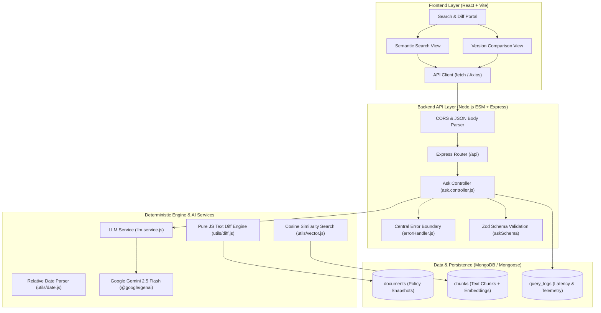

# PolicyLens

### Grounded Policy Search and Deterministic Temporal Change-Tracking Engine

[](https://developer.mozilla.org/en-US/docs/Web/JavaScript)
[](https://nodejs.org/)
[](https://expressjs.com/)
[](https://ai.google.dev/)
[](https://zod.dev/)
[](https://www.mongodb.com/)
[](https://react.dev/)
[](LICENSE)

PolicyLens is an intelligent policy search and temporal change-tracking platform operating over a corpus of synthetic, versioned institutional policy documents. The platform combines dense vector retrieval, in-memory cosine similarity, deterministic programmatic text diffing, and grounded Google Gemini summarization to provide auditable answers, verifiable revision histories, and honest refusals with zero hallucinated modifications.

---

## Table of Contents

- [Overview](#overview)
- [System Architecture](#system-architecture)
- [Architectural Philosophy](#architectural-philosophy)
- [Key Features](#key-features)
  - [Grounded Semantic Search](#grounded-semantic-search)
  - [Deterministic Change Tracking](#deterministic-change-tracking)
  - [Hallucination Prevention & Honest Fallbacks](#hallucination-prevention--honest-fallbacks)
  - [Multilingual Capability](#multilingual-capability)
  - [Operational Observability & Telemetry](#operational-observability--telemetry)
- [Technology Stack](#technology-stack)
- [Repository Structure](#repository-structure)
- [Prerequisites](#prerequisites)
- [Installation and Setup](#installation-and-setup)
  - [1. Clone Repository](#1-clone-repository)
  - [2. Environment Configuration](#2-environment-configuration)
  - [3. Install Dependencies](#3-install-dependencies)
  - [4. Gemini API Connectivity Smoke Test](#4-gemini-api-connectivity-smoke-test)
  - [5. Run Development Server](#5-run-development-server)
- [API Specification & Contracts](#api-specification--contracts)
  - [GET /api/health](#get-apihealth)
  - [POST /api/ask](#post-apiask)
  - [POST /api/search](#post-apisearch)
  - [POST /api/changes](#post-apichanges)
  - [POST /api/ask-policies](#post-apiask-policies)
- [Automated Testing & Verification](#automated-testing--verification)
- [Evaluation & Benchmarking Strategy](#evaluation--benchmarking-strategy)
- [Ethical Considerations & Data Integrity](#ethical-considerations--data-integrity)
- [Project Team & Hackathon Details](#project-team--hackathon-details)
- [License](#license)

---

## Overview

Institutional policies—such as college grading rules, hostel curfews, fee refund guidelines, and codes of conduct—evolve frequently across semesters. Traditional search engines fail to explain *what changed and when*, while standard LLM chatbots frequently hallucinate or confuse historical versions with current ones.

PolicyLens addresses these challenges through a strict separation between deterministic data processing and language generation:

1. **For Students and Faculty**: Natural-language query interface delivering concise answers supported by explicit document citations, direct quote snippets, and side-by-side revision comparisons.
2. **For Policy Administrators**: Instant audit trails of document modifications, temporal diff tracking across effective dates, and guaranteed refusal when queries fall outside the official corpus.

---

## System Architecture



---

## Architectural Philosophy

Large language models are inherently non-deterministic and prone to inventing revisions when tasked with comparing long texts. PolicyLens enforces a **4-step deterministic pipeline**:

```
User Query ("What hostel rules changed since March?")
    │
    ▼
[Step 1] Structured Intent Extraction (LLM)
    └── Returns JSON: { intent: "change_tracking", since: "March", topic: "hostel" }
    │
    ▼
[Step 2] Deterministic Date Resolution (Pure JavaScript)
    └── Resolves "since March" to "2026-03-01T00:00:00.000Z" based on server reference clock
    │
    ▼
[Step 3] Version Query & Structural Text Diff (MongoDB & Pure Code)
    └── Queries versions effective after resolved date
    └── Programmatically diffs version v2 against v1 using standard LCS/Myers diff algorithm
    │
    ▼
[Step 4] Grounded Summarization & Citation (LLM Generation)
    └── LLM receives ONLY the verified diff text and document metadata
    └── Produces bulleted summary citing exact clauses with zero invented changes
```

---

## Key Features

### Grounded Semantic Search
- **Dense Embedding Storage**: Chunks and embeddings are stored directly in MongoDB documents, avoiding external vector database overhead.
- **In-Memory Cosine Similarity**: Pure JavaScript vector similarity computation ensures transparency, zero external vendor lock-in, and explainability to judges.
- **Source Citations**: Every answer includes source policy titles, version tags, effective dates, and matched paragraph snippets.

### Deterministic Change Tracking
- **Temporal Version Queries**: Filter documents effective across specific date boundaries.
- **Programmatic Diffing**: Computes exact additions and deletions before prompting the model.
- **Grounded Summaries**: Eliminates hallucinated clause revisions.

### Hallucination Prevention & Honest Fallbacks
- **Corpus Boundary Enforcement**: System prompt strictly bounds generation to the retrieved context.
- **Explicit Refusals**: Out-of-scope questions immediately trigger a standardized "not found in documents" response rather than making plausible guesses.

### Multilingual Capability
- **Bilingual Ingestion**: Indexes institutional policies published in English and Hindi.
- **Cross-Lingual Retrieval**: Understands Hindi queries, retrieves corresponding Hindi policy chunks, and responds fluently in Hindi with appropriate citations.

### Operational Observability & Telemetry
- **Latency Tracking**: Measures external LLM invocation duration separately from internal Express routing.
- **Token Analytics**: Captures `promptTokenCount`, `candidatesTokenCount`, and `totalTokenCount` per transaction.
- **Sanitized Error Boundary**: Centralized Express middleware catches Zod validation failures (400) and unhandled crashes (500) without ever leaking stack traces, internal errors, or secrets.

---

## Technology Stack

All libraries, APIs, and models used in PolicyLens comply strictly with hackathon open-source and transparency rules:

| Layer | Technology | Package / Version | Role in Architecture |
| :--- | :--- | :--- | :--- |
| **Runtime** | Node.js | `v20.0.0+` | Native ES Modules environment (`"type": "module"`) |
| **Web Framework** | Express.js | `^5.3.0` | Routing, request pipeline, and centralized error handling |
| **Schema Validation** | Zod | `^4.6.7` | Strict validation for API payloads and structured LLM JSON outputs |
| **Foundation Model** | Google Gemini | `GEMINI_MODEL` (`gemini-2.5-flash`) | Intent parsing and diff summarization |
| **AI SDK** | Google Gen AI SDK | `@google/genai` (`^2.30.0`) | Official Node.js SDK for Gemini models |
| **Database** | MongoDB & Mongoose | `Local / Atlas` | Storage for versioned policies, chunks, embeddings, and logs |
| **Vector Engine** | Pure JavaScript | Native Math | In-memory cosine similarity (no LangChain, no external vector DB) |
| **Middleware & Security**| `cors`, `dotenv` | `^2.8.6`, `^18.0.8` | Cross-Origin Resource Sharing and environment isolation |
| **Frontend (Upcoming)**| React + Vite | React 19 / Vite | Clean single-page search and revision diff comparison UI |

---

## Repository Structure

```text
Policy-Lens/
├── .agent/
│   └── rules/
│       └── project-rules.md       # AI assistant rules, constraints, and boundaries
├── .github/
│   └── copilot-instructions.md    # Pair-programming instructions and tech stack rules
├── docs/
│   ├── PROJECT_CONTEXT.md         # Comprehensive hackathon master guide
│   └── PROGRESS.md                # 28-day preparation progress checklist
├── server/
│   ├── data/                      # Synthetic versioned policy corpus JSON files
│   ├── evals/                     # Benchmark dataset (~30 queries) and eval runner
│   ├── src/
│   │   ├── config/                # Database and GenAI SDK client initializers
│   │   ├── controllers/           # HTTP controllers (ask.controller.js)
│   │   ├── middleware/            # Central error handler (errorHandler.js)
│   │   ├── models/                # Mongoose schemas (Document, Chunk, QueryLog)
│   │   ├── routes/                # Express routers (ask.routes.js)
│   │   ├── services/              # Business logic & AI orchestration (llm.service.js)
│   │   ├── utils/                 # Cosine similarity, date parser, diff engine
│   │   ├── app.js                 # Express app configuration & middleware chain
│   │   ├── server.js              # HTTP server entry point & listener
│   │   └── hello.js               # Gemini API connectivity smoke test script
│   ├── package.json               # Server scripts and dependencies
│   └── package-lock.json
├── .env.example                   # Environment variable template
├── .gitignore                     # Git ignore rules (node_modules, .env, dist)
└── README.md                      # System documentation
```

---

## Prerequisites

- **Node.js**: `v20.0.0` or higher
- **Package Manager**: `npm` (v10+)
- **Operating System**: Windows (PowerShell), macOS, or Linux
- **Google Gemini API Key**: Obtainable from [Google AI Studio](https://aistudio.google.com/)
- **MongoDB**: Local MongoDB community server or MongoDB Atlas URI (required for Day 8+)

---

## Installation and Setup

### 1. Clone Repository

```bash
git clone https://github.com/Manas-Gupta16/Policy-Lens.git
cd Policy-Lens
```

### 2. Environment Configuration

Copy the environment template into the `server/` directory:

```powershell
# Windows PowerShell
Copy-Item .env.example server\.env
```

Open `server/.env` and supply your actual credentials:

```env
PORT=3000
GEMINI_API_KEY=your_actual_gemini_api_key
GEMINI_MODEL=gemini-2.5-flash
MONGODB_URI=mongodb://localhost:27017/policylens
```

> [!CAUTION]
> Never commit `server/.env` to version control. Keep `.gitignore` strictly updated.

### 3. Install Dependencies

```powershell
npm --prefix server install
```

### 4. Gemini API Connectivity Smoke Test

Verify your API key and connection to Google Gemini:

```powershell
node server/src/hello.js "Explain tokens to a beginner in 2 sentences."
```

Expected output:
```text
Tokens are the basic building blocks of text that AI models use to read and write...
--- usage ---
Input tokens: 11
Output tokens: 57
Total tokens: 68
```

### 5. Run Development Server

```powershell
npm --prefix server run dev
```

The server will start with hot-reloading at `http://localhost:3000`.

---

## API Specification & Contracts

All requests accept JSON payloads, validate structures with Zod, and use centralized error envelopes:
```json
{
  "error": {
    "code": "VALIDATION_ERROR",
    "message": "Specific explanation"
  }
}
```

### GET /api/health
Verifies that the API service is operational.
- **Status**: `200 OK`
- **Response**:
  ```json
  {
    "status": "ok"
  }
  ```

### POST /api/ask
Direct query endpoint testing question validation and Gemini generation.
- **Request Body**:
  ```json
  {
    "question": "What is the fee refund policy for hostel accommodation?"
  }
  ```
- **Validation**: `question` must be a trimmed string between 1 and 500 characters.
- **Response (`200 OK`)**:
  ```json
  {
    "answer": "Tokens are the basic fragments of text...",
    "usage": {
      "inputTokens": 7,
      "outputTokens": 26
    },
    "latencyMs": 1420
  }
  ```

### POST /api/search *(Upcoming)*
Retrieves semantically relevant policy chunks and citations.
- **Request Body**: `{ "question": "..." }`
- **Response (`200 OK`)**: `{ "answer": "...", "sources": [...], "found": true, "usage": {...}, "latencyMs": 1800 }`

### POST /api/changes *(Upcoming)*
Temporal change detection comparing policy versions effective after a given date.
- **Request Body**: `{ "since": "March 2026", "topic": "hostel" }`
- **Response (`200 OK`)**: `{ "changes": [...], "latencyMs": 2100 }`

### POST /api/ask-policies *(Upcoming)*
Unified routing pipeline that classifies user intent and routes to either `/search` or `/changes`.

---

## Automated Testing & Verification

Run these validation test cases against your local server to verify contract adherence:

```javascript
// Test script for Node.js / PowerShell
async function runTests() {
  const cases = [
    { name: "Health Check", url: "http://localhost:3000/api/health", method: "GET" },
    { name: "Valid Question", url: "http://localhost:3000/api/ask", method: "POST", body: { question: "What is an embedding?" } },
    { name: "Empty String", url: "http://localhost:3000/api/ask", method: "POST", body: { question: "" } },
    { name: "Whitespace String", url: "http://localhost:3000/api/ask", method: "POST", body: { question: "   " } },
    { name: "Missing Body", url: "http://localhost:3000/api/ask", method: "POST", body: {} },
    { name: "Wrong Type", url: "http://localhost:3000/api/ask", method: "POST", body: { question: 12345 } },
    { name: "Over 500 Chars", url: "http://localhost:3000/api/ask", method: "POST", body: { question: "a".repeat(600) } }
  ];

  for (const c of cases) {
    const opts = { method: c.method, headers: { "Content-Type": "application/json" } };
    if (c.body) opts.body = JSON.stringify(c.body);
    const res = await fetch(c.url, opts);
    console.log(`[${res.status}] ${c.name}`);
  }
}
runTests();
```

---

## Evaluation & Benchmarking Strategy

A dedicated evaluation suite in `server/evals/` benchmarks system performance across ~30 curated ground-truth scenarios:

- **10 Direct Lookups**: Fact retrieval across hostel, academic, and fee policies.
- **8 Temporal Change Queries**: Accurate detection of revisions effective after specific dates.
- **3 Multi-Policy Queries**: Cross-document reasoning and synthesis.
- **5 Out-of-Scope Queries**: Negative test cases ensuring the system admits when an answer is not present without hallucinating.
- **4 Hindi Queries**: Multilingual semantic retrieval and answer generation in Hindi.

### Metrics Captured
1. **Retrieval Precision**: Ratio of correctly retrieved policy chunks to ground-truth sections.
2. **Generation Faithfulness**: Absence of hallucinated details outside provided context chunks.
3. **Operational Telemetry**: Query latency percentiles ($p50$ and $p95$), input/output token counts, and estimated cost per query.

---

## Ethical Considerations & Data Integrity

- **Synthetic Data Exclusively**: PolicyLens uses exclusively synthetic policy documents modeled after university regulations. No personally identifiable information (PII) or proprietary institutional records are indexed.
- **Transparent Citations**: Every generated answer must cite its backing document title, version, and effective date.
- **Auditable Diffing**: All policy change explanations are backed by programmatic diff comparisons, ensuring absolute fidelity to source texts.

---

## Project Team & Hackathon Details

- **Event**: Homingo Hackathon, Edition 01 (Online, India)
- **Track**: LLM Apps Track
- **Team**: Catalysts (Captain & Sole Member)
- **Official Portal**: [https://hackathon.homingo.co.in/hackathons/edition-01](https://hackathon.homingo.co.in/hackathons/edition-01)
- **Practice Status**: This repository is a technical preparation workspace. The final hackathon project will be built in a fresh repository during the official build window (21 Nov – 6 Dec 2026).

---

## License

This project is licensed under the [ISC License](LICENSE).
